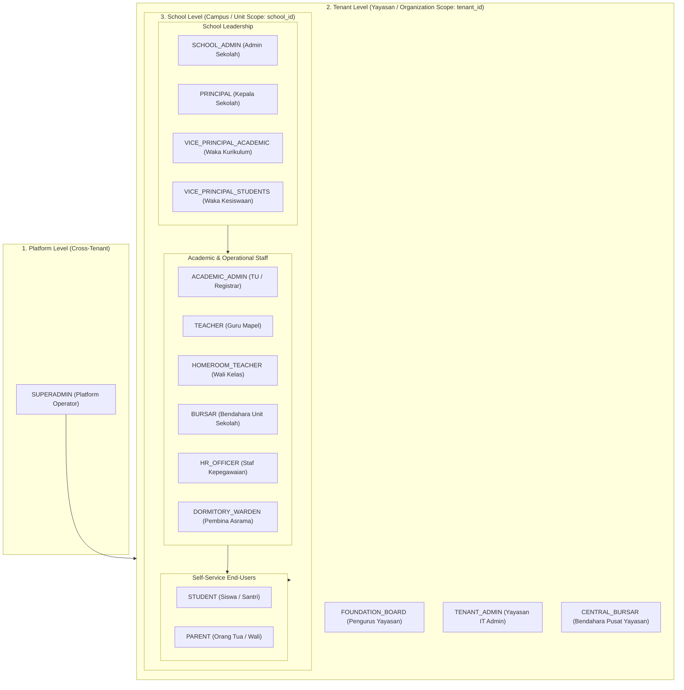
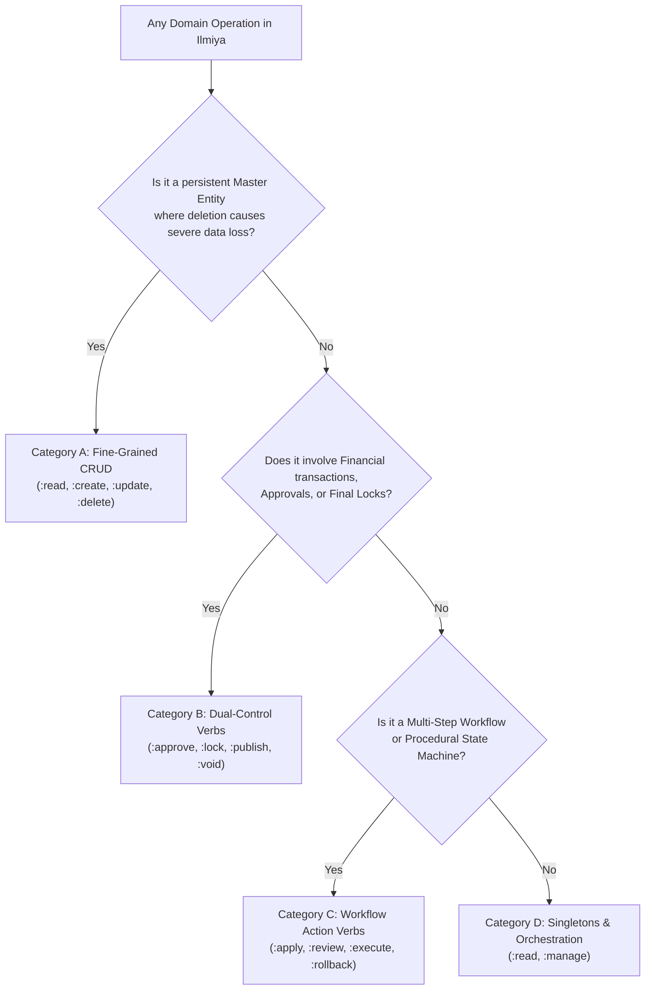

# Roles and Permissions Specification

## Overview

**Ilmiya** is a multi-tenant School Management System (SMS) and Educational ERP designed for primary, secondary, vocational, and Islamic educational institutions (SD, SMP, SMA, SMK, MI, MTs, MA, and Pesantren).

This document establishes the official business and security specification for **Role-Based Access Control (RBAC)** in Ilmiya. It defines:
1. **Tenancy, School, and Contextual Scopes** (distinguishing Tenant vs. School boundaries)
2. **Standard User Roles** across foundation, institutional, operational, and self-service tiers
3. **The Hybrid Authorization Architecture** (principled taxonomy combining fine-grained CRUD, segregation of duties, workflows, and pragmatic management)
4. **Fine-Grained Permissions Catalog** structured in `{domain}:{resource}:{action}` notation
5. **Role-to-Permission Matrix** detailing operational capabilities and contextual boundaries
6. **Technical Implementation Patterns** for multi-tenant and school-scoped enforcement

---

## 1. Tenancy Hierarchy: Tenant vs. School

In educational governance—particularly within foundations (*Yayasan*), school boards, or educational trusts—an organization frequently operates **multiple educational units** (e.g., an elementary school, junior high, senior high, and a pesantren). 

Ilmiya explicitly distinguishes between **`TENANT`** and **`SCHOOL`**:

```
Platform (Ilmiya Multi-Tenant Cloud / On-Premise)
   │
   └── Tenant: Yayasan Darussalam (tenant_id)
         │
         ├── School 1: SD Islam Darussalam (school_id: sch-sd-01)
         ├── School 2: SMP Islam Darussalam (school_id: sch-smp-01)
         ├── School 3: SMA Islam Darussalam (school_id: sch-sma-01)
         └── School 4: Pesantren Darussalam (school_id: sch-pes-01)
```

### 1.1 Architectural Comparison

| Dimension | `TENANT` (Organization / Foundation) | `SCHOOL` (Educational Unit / Campus) |
|---|---|---|
| **Identity** | `TenantId` (UUID string) | `SchoolId` (typed entity identifier) |
| **Real-World Entity** | Foundation (*Yayasan*), School Board, District, or Enterprise Account | Individual School, Madrasah, Vocational College, or Pesantren Unit |
| **Data Boundary** | **Hard Database Isolation**: Enforced by discriminator column `tenant_id` and Java 25 `ScopedValue` (`TenantContext`). Zero cross-tenant data leakage. | **Soft Relational Isolation**: Data belongs to a specific school unit (`school_id`), but resides within the same tenant boundary. |
| **Governance Scope** | Cross-school oversight, consolidated finances, platform billing/subscription, and centralized guardian/parent identity. | Local institutional operations, curriculum layout, classes, timetables, grading, e-Rapor, and daily attendance. |
| **Legal & Reg Identifiers** | Foundation legal deed, Tax ID (NPWP Yayasan), tenant billing account. | NPSN (Nomor Pokok Sekolah Nasional), institutional code, accreditation certificate (A/B/C), school address. |
| **Typical Leadership** | Foundation Board (*Pengurus Yayasan*), Foundation IT Admin. | Principal (*Kepala Sekolah / Mudir*), Vice Principals (*Waka*), School Admin. |

> [!IMPORTANT]
> **Single-School vs. Multi-School Tenants**:
> - **Single-School Tenant**: An independent private or public school where 1 Tenant = 1 School.
> - **Multi-School Tenant**: An educational foundation (*Yayasan*) where 1 Tenant = N Schools. Centralized administrators and parents operate across schools, while teachers, principals, and students operate within their specific school unit.

---

### 1.2 Authorization Levels



---

### 1.3 Contextual Data Boundary Scopes

Beyond coarse-grained role permissions, Ilmiya evaluates **contextual data boundaries**:

| Scope Code | Scope Name | Boundary Level | Description | Example Application |
|---|---|---|---|---|
| **`GLOBAL`** | Platform-Wide | Platform | Applies across all tenants. Only accessible by platform superadministrators. | Tenant provisioning, global system health, infrastructure migrations |
| **`TENANT`** | Organization Scope | Tenant (`tenant_id`) | Encompasses all schools and units under the active tenant foundation. | Foundation board reviewing consolidated tuition income across 4 schools |
| **`SCHOOL`** | School Unit Scope | School (`school_id`) | Constrained to a specific school unit within the tenant. | Principal approving academic term calendars for SMP Islam Darussalam |
| **`HOMEROOM`** | Homeroom Scope | Class Batch | Restricted to the student batch or class supervised by the homeroom teacher (*Wali Kelas*). | Reviewing semester e-Rapor remarks, checking morning roll call |
| **`ASSIGNED`** | Subject / Teacher Scope | Teaching Slot | Restricted to classes, courses, or subjects directly allocated to the teacher in the timetable. | Recording midterm exam marks for 10-A Mathematics |
| **`SELF`** | User Self-Service | User Profile | Restricted strictly to the authenticated user's own profile and records. | Teacher requesting annual leave, student viewing personal exam schedule |
| **`WARD`** | Guardian Scope | Linked Children | Restricted to students actively linked to the parent/guardian user account across the tenant. | Parent viewing report cards for Child A (in SD) and Child B (in SMP) under one login |

---

## 2. Standard Role Definitions

Roles in Ilmiya represent logical collections of permissions suited to institutional job functions.

### Tier 1: Platform Administration

#### `SUPERADMIN` (Platform Administrator)
- **Scope**: Platform-wide (`GLOBAL`).
- **Persona**: Ilmiya SaaS operations engineer or hosting provider system administrator.
- **Responsibilities**:
  - Provision, activate, suspend, and archive school tenants.
  - Monitor global system health, database migrations, and resource metrics.
  - Manage platform-wide feature flags and tenant licensing tiers.
  - Does not participate in daily school academic operations.

---

### Tier 2: Foundation & Organization Governance (Tenant Scope)

#### `TENANT_ADMIN` (Administrator Yayasan / Foundation Admin)
- **Scope**: Entire Foundation (`TENANT`).
- **Persona**: Foundation central IT director or management executive.
- **Responsibilities**:
  - Register and provision new school units (`SchoolId`) under the foundation tenant.
  - Manage tenant-wide security policies, SSO integrations, and subscription billing.
  - Assign foundation-level roles and supervise school-level administrator accounts.
  - Access tenant-wide audit trails.

#### `FOUNDATION_BOARD` (Pengurus Yayasan / Board of Trustees)
- **Scope**: Entire Foundation (`TENANT`).
- **Persona**: Board member, foundation trustee, or executive director managing one or multiple schools under a yayasan.
- **Responsibilities**:
  - Strategic oversight of student enrollment, retention trends, and capacity across all schools.
  - Consolidated financial reporting (overall tuition collection, outstanding arrears aging, foundation cash balances).
  - High-level academic performance summaries and graduation rates across units.
  - Read-only governance access; no day-to-day transactional entry.

---

### Tier 3: School Leadership & Governance (School Scope)

#### `SCHOOL_ADMIN` (Administrator Sekolah)
- **Scope**: Specific School Unit (`SCHOOL`).
- **Persona**: School IT administrator or head of administrative computer operations.
- **Responsibilities**:
  - Configure the school profile (school name, NPSN, address, contact, branding logo).
  - Setup school operational settings (working days, grading format preference, term layouts).
  - Manage school staff user accounts, password resets, and role assignments for the school.
  - Access school-level audit logs and data export/import utilities.

#### `PRINCIPAL` (Kepala Sekolah / Mudir)
- **Scope**: Specific School Unit (`SCHOOL`).
- **Persona**: Head of school, madrasah headmaster, or mudir pesantren.
- **Responsibilities**:
  - Institutional governance, staff leadership, and academic policy compliance.
  - Final approval and digital locking of semester grades and e-Rapor report cards (`exam:grade:lock`, `exam:report-card:publish`).
  - Final approval of staff leave requests and major disciplinary actions.
  - Sign off on official compliance reports (Dapodik / EMIS).

#### `VICE_PRINCIPAL_ACADEMIC` (Wakil Kepala Sekolah Bidang Kurikulum)
- **Scope**: Specific School Unit (`SCHOOL`).
- **Persona**: Vice principal for curriculum and academic development.
- **Responsibilities**:
  - Configure academic years, semesters/terms, and curriculum frameworks (Kurikulum Merdeka / K13).
  - Maintain master subject catalog and allocate subjects to classes.
  - Design and publish class timetable schedules and institutional academic calendars.
  - Oversee exam schedules, assessment components, and grade submission deadlines.
  - Execute end-of-year student promotion and graduation workflows.

#### `VICE_PRINCIPAL_STUDENTS` (Wakil Kepala Sekolah Bidang Kesiswaan)
- **Scope**: Specific School Unit (`SCHOOL`).
- **Persona**: Vice principal for student affairs and extracurricular activities.
- **Responsibilities**:
  - Oversee student admissions (PPDB / Penerimaan Peserta Didik Baru).
  - Manage student conduct, disciplinary infractions, and merit/demerit point records.
  - Supervise extracurricular allocations and student council (OSIS / IPM) activities.
  - Coordinate student counseling, attendance interventions, and parent notifications.

---

### Tier 4: Academic, Operational & Administrative Staff (School Scope)

#### `ACADEMIC_ADMIN` (Staf Tata Usaha / TU / Registrar)
- **Scope**: Specific School Unit (`SCHOOL`).
- **Persona**: School administration office staff (*Staf Tata Usaha*).
- **Responsibilities**:
  - Register new students and verify civil documents (birth certificates, KK, NISN).
  - Manage class batch enrollments and class transfers.
  - Generate official school documentation (surat keterangan aktif, transkrip sementara).
  - Compile and verify Dapodik/EMIS export datasets.

#### `TEACHER` (Guru Mata Pelajaran / Ustadz)
- **Scope**: Assigned Classes & Subjects (`ASSIGNED`) within `SCHOOL`, plus self-service (`SELF`).
- **Persona**: Subject educator or pesantren religious teacher.
- **Responsibilities**:
  - View personal teaching timetable and schedule allocations.
  - Take period-level subject attendance during teaching blocks.
  - Create assessments (formative quizzes, homework, summative exams) and input marks.
  - Provide qualitative remarks on student learning competencies.

#### `HOMEROOM_TEACHER` (Wali Kelas)
- **Scope**: Supervised Class Batch (`HOMEROOM`) within `SCHOOL`, plus `TEACHER` permissions.
- **Persona**: Classroom supervisor and primary student mentor.
- **Responsibilities**:
  - Conduct daily morning roll call and track student absence reasons (sakit, izin, alpa).
  - Verify parent doctor's notes and excuse letters (`attendance:student:excuse`).
  - Monitor aggregate academic progress, attendance percentages, and behavior of homeroom students.
  - Synthesize subject grades, extracurricular participation, and write character notes for semester e-Rapor.
  - Generate and review draft student report cards before principal lock.

#### `BURSAR` (Bendahara / Staf Keuangan)
- **Scope**: Specific School Unit (`SCHOOL`) or Foundation Central (`TENANT` if centralized).
- **Persona**: School cashier, bursar, or finance officer (*Tata Usaha Keuangan*).
- **Responsibilities**:
  - Configure fee schedules (SPP bulanan, uang gedung/pangkal, praktikum, seragam, buku).
  - Set up student fee concessions, scholarships (KIP, Beasiswa Prestasi), and sibling discounts.
  - Generate monthly student fee invoices and payment reminders.
  - Receive cash/bank transfer payments, record transactions, and issue official receipts.
  - Maintain daily cashbooks and prepare debt/arrears tracking reports.

#### `HR_OFFICER` (Staf Kepegawaian / HR)
- **Scope**: Specific School Unit (`SCHOOL`) or Foundation Central (`TENANT` if centralized).
- **Persona**: Human resources officer or administrative staff in charge of employment.
- **Responsibilities**:
  - Maintain employee records for permanent teachers (GTY/PNS), honorarium teachers (GTT), and administrative staff.
  - Track employment contracts, NUPTK, certifications, and teaching hour quotas.
  - Manage staff daily attendance logs and leave balances.
  - Calculate monthly payroll batches, allowances (tunjangan wali kelas/mengajar), deductions (kasbon), and distribute payslips.

#### `DORMITORY_WARDEN` (Pembina Asrama / Musyrif) *(Pesantren / Boarding)*
- **Scope**: Supervised Dormitory Rooms/Halqah (`HOMEROOM` equivalent) within `SCHOOL`.
- **Persona**: Boarding school supervisor or pesantren dorm mentor (*Musyrif / Musyrifah*).
- **Responsibilities**:
  - Manage boarding student check-in, night curfews, and hostel attendance.
  - Monitor boarding routines (shalat berjamaah, tahfidz Al-Qur'an, kajian kitab kuning).
  - Process student weekend exit permits (izin pesiar / pulang).
  - Record disciplinary incidents or health complaints occurring inside the dormitory.

---

### Tier 5: Self-Service End-Users

#### `STUDENT` (Siswa / Santri)
- **Scope**: Self (`SELF`) within their enrolled `SCHOOL`.
- **Persona**: Enrolled student or pesantren santri.
- **Responsibilities**:
  - View personal daily timetable, room locations, and teacher allocations.
  - View personal attendance history and monthly summary percentages.
  - Check upcoming examination schedules, homework, and continuous assessment marks.
  - Download published semester report cards (e-Rapor).
  - View fee billing status and payment history.

#### `PARENT` (Orang Tua / Wali Murid)
- **Scope**: Linked Children (`WARD`) across all schools in the `TENANT`.
- **Persona**: Father, mother, or legal guardian of enrolled students.
- **Key Tenancy Feature**: A single parent user account is bound to the **Tenant**, allowing them to switch seamlessly between children studying in different schools under the same foundation (e.g. child in Elementary and child in High School).
- **Responsibilities**:
  - View real-time attendance alerts and morning roll call notifications for linked children.
  - Submit digital absence requests along with doctor's notes (surat keterangan dokter).
  - Monitor academic marks, teacher remarks, and download certified e-Rapor.
  - Review upcoming fee invoices (SPP), download payment receipts, and view payment balances.
  - Access school announcements, circular letters, and event calendars.

---

## 3. The Hybrid Authorization Model

Ilmiya rejects both pure coarse-grained bundling (which creates security and audit vulnerabilities) and universal micro-CRUD (which creates token bloat and unmanageable complexity). Instead, permissions are governed by a **4-Tier Hybrid Taxonomy**:



### Taxonomy Classification Rules

1. **Category A: Core Master Entities (Fine-Grained CRUD)**:
   - *Pattern*: `{domain}:{resource}:read`, `{domain}:{resource}:create`, `{domain}:{resource}:update`, `{domain}:{resource}:delete`.
   - *Rationale*: Crucial permanent entities (students, courses, classes, fee structures, staff) must separate creation and editing from **destruction**. A junior registrar can register and update students without possessing the authority to delete records.
2. **Category B: High-Risk Segregation of Duties (Dual-Control Verbs)**:
   - *Pattern*: Dedicated domain verbs enforcing the Four-Eyes Principle / Maker-Checker pattern.
   - *Rationale*: High-risk financial operations and compliance sign-offs require strict segregation. For example, a cashier can record payments (`finance:payment:create`), but only a senior bursar or principal can void a posted receipt (`finance:payment:void`). Teachers enter marks (`exam:grade:create`), but only the principal locks the grades (`exam:grade:lock`).
3. **Category C: Multi-Step Business Workflows (Lifecycle Verbs)**:
   - *Pattern*: Verbs aligned with procedural domain steps (`:apply`, `:review`, `:execute`, `:rollback`, `:calculate`, `:disburse`).
   - *Rationale*: Admissions (PPDB), year-end promotions, and monthly payroll are not simple CRUD rows; they are business workflows transitioning through distinct states.
4. **Category D: Singletons, Settings & Orchestrations (Pragmatic `:manage`)**:
   - *Pattern*: `{domain}:{resource}:read`, `{domain}:{resource}:manage` (or `:update`).
   - *Rationale*: Single-instance records (school operational settings) and relational coordination mappings (parent-student linkage, teacher timetable allocation) do not benefit from micro-CRUD. Using `:manage` prevents permission bloat without compromising safety.

---

## 4. Fine-Grained Permissions Catalog

All permissions adhere strictly to `{domain}:{resource}:{action}` syntax, supporting `ed-iam` wildcard matching (`domain:*` or `domain:resource:*`).

### 4.1 Tenant & Foundation Administration (`tenant:*`)

| Permission String | Category | Description |
|---|:---:|---|
| `tenant:management:read` | Cat A (CRUD) | View registered tenants and organization details. |
| `tenant:management:create` | Cat A (CRUD) | Provision new tenant organizations on the platform. |
| `tenant:management:update` | Cat A (CRUD) | Update tenant subscription and organization profile. |
| `tenant:management:delete` | Cat A (CRUD) | Deactivate or archive a tenant organization. |
| `tenant:profile:read` | Cat D (Settings) | View foundation/tenant profile and corporate data. |
| `tenant:profile:update` | Cat D (Settings) | Update foundation corporate details and tax ID. |
| `tenant:school:manage` | Cat D (Orchestration)| Register, activate, or decommission school units under the foundation. |
| `tenant:subscription:read` | Cat D (Settings) | View platform licensing tiers and renewal dates. |
| `tenant:audit:read` | Audit | Inspect cross-school immutable audit logs across the tenant. |

### 4.2 School Profile, Settings & Users (`school:*`)

| Permission String | Category | Description |
|---|:---:|---|
| `school:profile:read` | Cat D (Settings) | View school unit profile details (NPSN, address, contact, branding). |
| `school:profile:update` | Cat D (Settings) | Modify school profile, accreditation details, and branding assets. |
| `school:settings:read` | Cat D (Settings) | View operational parameters (working days, grading format, term layout). |
| `school:settings:manage` | Cat D (Settings) | Configure institutional operational parameters. |
| `school:user:read` | Cat A (CRUD) | View school staff user accounts. |
| `school:user:create` | Cat A (CRUD) | Provision new user accounts and send invites. |
| `school:user:update` | Cat A (CRUD) | Update user profiles, active status, or assign school roles. |
| `school:user:delete` | Cat A (CRUD) | Hard-delete or revoke user accounts. |
| `school:audit:read` | Audit | Inspect school-level immutable audit logs. |

### 4.3 Academic Structure & Curriculum (`academic:*`)

| Permission String | Category | Description |
|---|:---:|---|
| `academic:year:read` | Cat A (CRUD) | View academic years and operational status. |
| `academic:year:create` | Cat A (CRUD) | Provision a new academic year. |
| `academic:year:update` | Cat A (CRUD) | Update dates or activate/archive an academic year. |
| `academic:year:delete` | Cat A (CRUD) | Remove an empty/unactivated academic year. |
| `academic:term:read` | Cat A (CRUD) | View academic terms and semester boundaries. |
| `academic:term:create` | Cat A (CRUD) | Add a new term/semester to an academic year. |
| `academic:term:update` | Cat A (CRUD) | Update term dates or activate/close terms. |
| `academic:term:delete` | Cat A (CRUD) | Delete an empty academic term. |
| `academic:curriculum:read` | Cat D (Settings) | Browse curriculum frameworks, learning objectives, and syllabi. |
| `academic:curriculum:manage` | Cat D (Settings) | Configure curriculum structures and grading standards. |
| `academic:course:read` | Cat A (CRUD) | View master subject catalog. |
| `academic:course:create` | Cat A (CRUD) | Create new subjects in the catalog. |
| `academic:course:update` | Cat A (CRUD) | Modify subject details, category, or credit hours. |
| `academic:course:delete` | Cat A (CRUD) | Delete an unused subject from the catalog. |
| `academic:class:read` | Cat A (CRUD) | View grade levels, batch sections, and class enrollments. |
| `academic:class:create` | Cat A (CRUD) | Create new class batch sections (e.g. 7-A, 10-IPA-1). |
| `academic:class:update` | Cat A (CRUD) | Edit class section details, room, and capacity. |
| `academic:class:delete` | Cat A (CRUD) | Delete an empty class batch section. |
| `academic:promotion:read` | Cat C (Workflow) | View class promotion criteria and candidate lists. |
| `academic:promotion:execute` | Cat C (Workflow) | Execute year-end student promotion, retention, or graduation batch. |
| `academic:promotion:rollback`| Cat C (Workflow) | Revert an executed promotion batch in case of error. |

### 4.4 Student Lifecycle & Admissions (`student:*`)

| Permission String | Category | Description |
|---|:---:|---|
| `student:profile:read` | Cat A (CRUD) | View student demographic and academic profile data. |
| `student:profile:create` | Cat A (CRUD) | Register and enroll new students. |
| `student:profile:update` | Cat A (CRUD) | Update student master records and contact details. |
| `student:profile:delete` | Cat A (CRUD) | Purge student records (restricted high-privilege action). |
| `student:admission:read` | Cat C (Workflow) | Browse admissions / PPDB applicant lists and statuses. |
| `student:admission:apply` | Cat C (Workflow) | Register prospective applicant into the PPDB portal. |
| `student:admission:review` | Cat C (Workflow) | Input entrance test results, interview notes, and review files. |
| `student:admission:approve`| Cat C (Workflow) | Officially admit applicant and trigger student profile creation. |
| `student:enrollment:manage`| Cat D (Orchestration)| Assign, transfer, or reallocate students to class batches. |
| `student:guardian:manage` | Cat D (Orchestration)| Link parent/guardian accounts to student profiles. |
| `student:document:read` | Cat A (CRUD) | Download student civil documentation (KK, akta kelahiran, ijazah). |
| `student:document:upload` | Cat A (CRUD) | Upload verified student identity documents. |
| `student:document:delete` | Cat A (CRUD) | Delete erroneous document attachments. |
| `student:conduct:read` | Cat A/B | View student disciplinary records, infractions, and merits. |
| `student:conduct:record` | Cat A/B | Record behavioral infractions and demerit/merit points. |
| `student:conduct:update` | Cat A/B | Update disciplinary notes and follow-up interventions. |
| `student:conduct:delete` | Cat A/B | Expunge or remove a disciplinary record (restricted). |

### 4.5 Attendance Tracking (`attendance:*`)

| Permission String | Category | Description |
|---|:---:|---|
| `attendance:student:read` | Cat A (Read) | View student daily and period attendance records. |
| `attendance:student:record` | Cat A/B | Submit daily or period roll call (present, sick, permitted, absent). |
| `attendance:student:update` | Cat A/B | Amend or correct recorded student attendance logs. |
| `attendance:student:excuse` | Cat B (Dual-Control)| Submit and approve absence justification letters and medical certificates. |
| `attendance:staff:read` | Cat A (Read) | View staff daily check-in and attendance summaries. |
| `attendance:staff:record` | Cat A | Record staff daily attendance check-in/check-out. |
| `attendance:staff:approve` | Cat B (Dual-Control)| Review and approve staff attendance corrections or remote check-ins. |

### 4.6 Timetable & Institutional Calendar (`timetable:*`)

| Permission String | Category | Description |
|---|:---:|---|
| `timetable:schedule:read` | Cat A (Read) | View class schedules, period timing sets, and teacher allocations. |
| `timetable:schedule:create` | Cat A (CRUD) | Create draft class schedule slots and room allocations. |
| `timetable:schedule:update` | Cat A (CRUD) | Reallocate teachers, rooms, or period times. |
| `timetable:schedule:delete` | Cat A (CRUD) | Remove class timetable schedule entries. |
| `timetable:schedule:publish`| Cat B (Dual-Control)| Officially publish verified timetable to teachers, students, and parents. |
| `timetable:calendar:read` | Cat D (Settings) | View school calendar events, exam weeks, and holidays. |
| `timetable:calendar:manage` | Cat D (Settings) | Create, update, or cancel institutional calendar events and holidays. |

### 4.7 Examination, Assessment & e-Rapor (`exam:*`)

| Permission String | Category | Description |
|---|:---:|---|
| `exam:schedule:read` | Cat A (CRUD) | View examination timetables and assessment periods. |
| `exam:schedule:create` | Cat A (CRUD) | Configure exam sessions (PTS, PAS, Asesmen Sumatif). |
| `exam:schedule:update` | Cat A (CRUD) | Adjust exam dates, proctors, and rooms. |
| `exam:schedule:delete` | Cat A (CRUD) | Delete an exam session schedule. |
| `exam:grade:read` | Cat A (Read) | View recorded marks and component scores. |
| `exam:grade:create` | Cat B (Dual-Control)| Record formative, summative, and homework scores for assigned classes. |
| `exam:grade:update` | Cat B (Dual-Control)| Update recorded marks before grade submission deadline. |
| `exam:grade:lock` | Cat B (Dual-Control)| Finalize and digitally lock grade entries to prevent further modifications. |
| `exam:report-card:read` | Cat A (Read) | View compiled e-Rapor student progress reports. |
| `exam:report-card:generate` | Cat B (Dual-Control)| Aggregate scores, attendance, extracurriculars, and generate draft report cards. |
| `exam:report-card:publish` | Cat B (Dual-Control)| Officially certify and release digital e-Rapor cards to student and parent portals. |

### 4.8 Finance, Fee Management & Cashbook (`finance:*`)

| Permission String | Category | Description |
|---|:---:|---|
| `finance:fee:read` | Cat A (CRUD) | View fee catalog, fee schedules, and pricing rules. |
| `finance:fee:create` | Cat A (CRUD) | Define new fee components (SPP, gedung, seragam) and scholarships. |
| `finance:fee:update` | Cat A (CRUD) | Adjust fee amounts and discount criteria. |
| `finance:fee:delete` | Cat A (CRUD) | Delete an unreferenced fee component. |
| `finance:invoice:read` | Cat A (Read) | View student billing statements and invoices. |
| `finance:invoice:create` | Cat A (CRUD) | Generate recurring monthly fee invoices and ad-hoc bills. |
| `finance:payment:read` | Cat A (Read) | View payment history, payment receipts, and collection logs. |
| `finance:payment:create` | Cat B (Dual-Control)| Record fee collection transactions and issue signed receipts. |
| `finance:payment:void` | Cat B (Dual-Control)| Void or reverse an erroneously posted payment record (restricted privilege). |
| `finance:report:read` | Cat A (Read) | View fee collection summaries, cashbook ledgers, and overdue arrears aging. |

### 4.9 Human Resources & School Payroll (`hr:*`)

| Permission String | Category | Description |
|---|:---:|---|
| `hr:staff:read` | Cat A (CRUD) | View staff master profiles, departments, and designations. |
| `hr:staff:create` | Cat A (CRUD) | Register new employees and teachers. |
| `hr:staff:update` | Cat A (CRUD) | Update employee records, contracts, NUPTK, and certifications. |
| `hr:staff:delete` | Cat A (CRUD) | Remove an employee record (restricted high-privilege action). |
| `hr:assignment:read` | Cat D (Orchestration)| View teacher subject allocations and homeroom appointments. |
| `hr:assignment:manage` | Cat D (Orchestration)| Assign teaching allocations, subject responsibilities, and homeroom roles. |
| `hr:leave:request` | Cat B (Dual-Control)| Submit employee leave applications. |
| `hr:leave:approve` | Cat B (Dual-Control)| Review, approve, or reject staff leave requests. |
| `hr:payroll:read` | Cat C (Workflow) | View salary components and personal/school payslips. |
| `hr:payroll:calculate` | Cat C (Workflow) | Execute monthly payroll calculations based on attendance and teaching hours. |
| `hr:payroll:disburse` | Cat C (Workflow) | Finalize payroll disbursement batches and release payslips. |

### 4.10 Audit Trail (`audit:*`)

| Permission String | Category | Description |
|---|:---:|---|
| `audit:log:read` | Audit | Inspect immutable audit logs of domain mutations. |

---

## 5. Role-to-Permission Matrix

The following matrix defines the operational capabilities assigned to each standard role under the **Hybrid Authorization Model**.

### Legend
- **`ALL`**: Complete administrative management across the resource (`domain:resource:*` or `domain:*`).
- **`Read`**: Read-only access across the role's scope (`Tenant` for Foundation Board, `School` for School Staff).
- **`C / U`**: Create and Update only (deletion restricted).
- **`C / U / D`**: Full CRUD (Create, Update, Delete).
- **`Scoped`**: Permission granted but dynamically bounded by data ownership:
  - `Assigned`: Classes or subjects assigned to the teacher in the timetable.
  - `Homeroom`: Students belonging to the teacher's supervised homeroom class.
  - `Self`: User's own personal records.
  - `Ward`: Linked child/children of the parent (cross-school within the tenant).
- **`Action Verbs`**: Specific high-privilege governance workflow actions (`Approve`, `Lock`, `Publish`, `Void`).
- **`—`**: No access.

| Resource / Capability | `SUPERADMIN` | `TENANT_ADMIN` | `FOUNDATION_BOARD` | `SCHOOL_ADMIN` | `PRINCIPAL` | `WAKA_KURIKULUM` | `WAKA_KESISWAAN` | `ACADEMIC_ADMIN` | `TEACHER` | `HOMEROOM_TEACHER` | `BURSAR` | `HR_OFFICER` | `STUDENT` | `PARENT` |
|---|:---:|:---:|:---:|:---:|:---:|:---:|:---:|:---:|:---:|:---:|:---:|:---:|:---:|:---:|
| **Operating Scope** | `GLOBAL` | `TENANT` | `TENANT` | `SCHOOL` | `SCHOOL` | `SCHOOL` | `SCHOOL` | `SCHOOL` | `ASSIGNED` | `HOMEROOM` | `SCHOOL/TENANT` | `SCHOOL/TENANT` | `SELF` | `WARD` |
| **`tenant:management`** | ALL | Read | Read | — | — | — | — | — | — | — | — | — | — | — |
| **`tenant:profile`** | ALL | ALL | Read | — | — | — | — | — | — | — | — | — | — | — |
| **`tenant:school`** | ALL | ALL | Read | — | — | — | — | — | — | — | — | — | — | — |
| **`school:profile`** | ALL | ALL | Read | ALL | Read | Read | Read | Read | Read | Read | Read | Read | Read | Read |
| **`school:settings`** | ALL | ALL | Read | ALL | Read | — | — | — | — | — | — | — | — | — |
| **`school:user`** | ALL | ALL | Read | ALL | Read | — | — | — | — | — | — | — | — | — |
| **`academic:year/term`** | ALL | Read | Read | ALL | ALL | ALL | Read | Read | Read | Read | Read | Read | Read | Read |
| **`academic:curriculum`**| ALL | Read | Read | ALL | Read | ALL | — | Read | Read | Read | — | — | — | — |
| **`academic:course`** | ALL | Read | Read | ALL | Read | ALL | — | C / U | Read | Read | — | — | — | — |
| **`academic:class`** | ALL | Read | Read | ALL | Read | ALL | Read | C / U | Read | Read | — | — | Scoped | Scoped |
| **`academic:promotion`**| ALL | — | — | ALL | Approve | ALL | Read | Execute | — | Input | — | — | — | — |
| **`student:profile`** | ALL | Read | Read | ALL | Read | Read | C / U / D | C / U | Scoped | Homeroom | Read | — | Self | Ward |
| **`student:admission`**| ALL | Read | Read | ALL | Approve | — | ALL | Apply/Rev | — | — | Read | — | — | — |
| **`student:enrollment`**| ALL | Read | Read | ALL | Read | Manage | ALL | ALL | — | — | — | — | — | — |
| **`student:guardian`** | ALL | Read | Read | ALL | Read | — | Manage | ALL | — | Homeroom | Read | — | Self | Ward |
| **`student:document`** | ALL | Read | — | ALL | Read | — | C / U / D | C / U | — | Homeroom | — | — | Self | Ward |
| **`student:conduct`** | ALL | Read | Read | ALL | Read | Read | C / U / D | Read | Record | Record/Edit | — | — | Self | Ward |
| **`attendance:student`**| ALL | Read | Read | ALL | Read | Read | ALL | Manage | Record | Record/Excuse | — | — | Self | Ward/Excuse |
| **`attendance:staff`** | ALL | Read | Read | ALL | ALL | Read | Read | Read | Self | Self | — | ALL | — | — |
| **`timetable:schedule`**| ALL | Read | Read | ALL | Read | ALL | Read | Read | Assigned | Homeroom | — | — | Self | Ward |
| **`timetable:calendar`**| ALL | Read | Read | ALL | ALL | ALL | ALL | Read | Read | Read | Read | Read | Read | Read |
| **`exam:schedule`** | ALL | Read | Read | ALL | Read | ALL | Read | Read | Read | Read | — | — | Self | Ward |
| **`exam:grade`** | ALL | Read | Read | ALL | Lock | Review | — | Read | Record/Edit | Record/Edit | — | — | Self | Ward |
| **`exam:report-card`** | ALL | Read | Read | ALL | Publish | Review | Read | Generate | Input | Generate | — | — | Self | Ward |
| **`finance:fee`** | ALL | Read | Read | ALL | Read | — | — | Read | — | — | ALL | — | Read | Read |
| **`finance:invoice`** | ALL | Read | Read | ALL | Read | — | — | — | — | — | ALL | — | Self | Ward |
| **`finance:payment`** | ALL | Read | Read | ALL | Read | — | — | — | — | — | Create (No Void)| — | Self | Ward/Create |
| **`finance:report`** | ALL | ALL | ALL | ALL | Read | — | — | — | — | — | ALL | — | — | — |
| **`hr:staff`** | ALL | Read | Read | ALL | Read | Read | Read | Read | Self | Self | — | ALL | — | — |
| **`hr:assignment`** | ALL | Read | Read | ALL | Read | ALL | — | Read | Read | Read | — | ALL | — | — |
| **`hr:leave`** | ALL | — | — | ALL | Approve | — | — | — | Request | Request | Request | ALL | — | — |
| **`hr:payroll`** | ALL | Read | Read | ALL | Read | — | — | — | Self | Self | Read | ALL | — | — |
| **`audit:log`** | ALL | ALL | Read | ALL | Read | — | — | — | — | — | — | — | — | — |

---

## 6. Security & Technical Implementation Guide

### 6.1 Enforcing Tenant Isolation vs. School Scoping

Ilmiya utilizes a two-tier context evaluation:
1. **Tier 1 (Tenant Boundary)**: Evaluated at the HTTP filter and database query level via `TenantContext` (`ScopedValue<TenantId>`). The database automatically appends `tenant_id = :currentTenantId` to prevent cross-foundation leakage.
2. **Tier 2 (School Scope)**: Evaluated at the application use-case level. Requests carrying school-specific operations identify the target unit via path parameter (e.g. `/api/v1/schools/{schoolId}/...`) or header `X-School-ID`.

```
Incoming Request
      │
      ▼
┌─────────────────────────────────┐
│       TenantContextFilter       │───► Binds X-Tenant-ID to TenantContext (ScopedValue)
└───────────────┬─────────────────┘
                ▼
┌─────────────────────────────────┐
│     JwtAuthenticationFilter     │───► Validates Bearer Token & User Permissions
└───────────────┬─────────────────┘
                ▼
┌─────────────────────────────────┐
│       @RequirePermission        │───► Validates fine permission (e.g. academic:course:create)
└───────────────┬─────────────────┘
                ▼
┌─────────────────────────────────┐
│ Use Case (Domain Authorization) │───► Validates School Scope & Data Ownership
└─────────────────────────────────┘
```

### 6.2 Wildcard Matching with the Hybrid Model

The `ed-iam` permission evaluation engine natively resolves hierarchical wildcards, enabling high-privilege administrators to maintain simple permission sets while enforcing strict boundaries on operational staff:

- **Full Domain Access**: `academic:*` automatically grants `:read`, `:create`, `:update`, `:delete`, `:execute`, and `:rollback`.
- **Resource-Level Access**: `academic:course:*` automatically grants `academic:course:read`, `academic:course:create`, `academic:course:update`, and `academic:course:delete`.
- **Restricted Access**: An Academic Clerk given `academic:course:read`, `academic:course:create`, and `academic:course:update` has full authoring capability **without** the permission to delete courses.
- **Financial Segregation**: A bursar cashier given `finance:payment:create` and `finance:payment:read` can collect SPP and issue receipts, but **cannot** call endpoints guarded by `finance:payment:void`.
