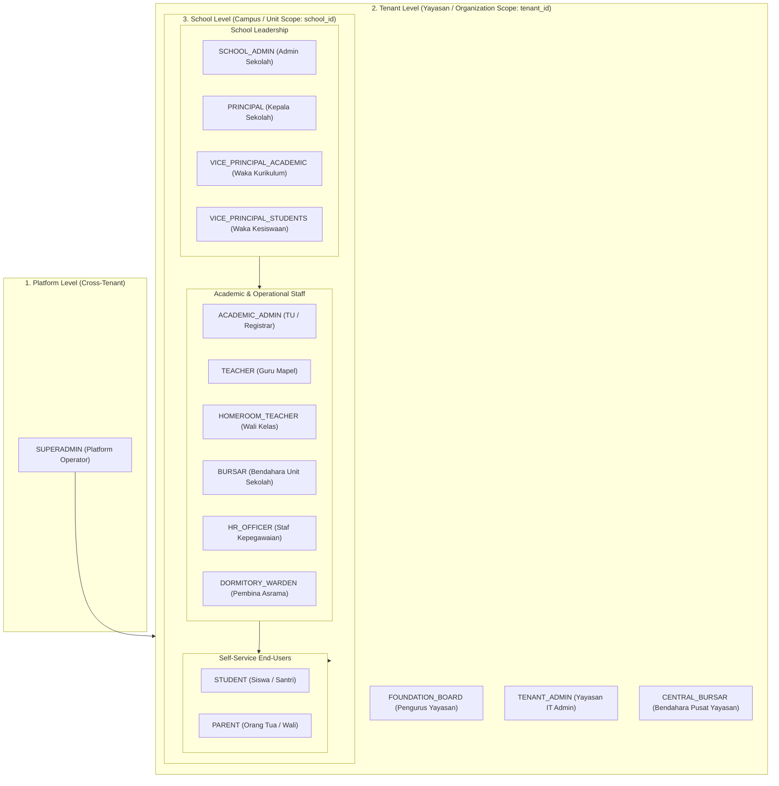

# Roles and Permissions Specification

## Overview

**Ilmiya** is a multi-tenant School Management System (SMS) and Educational ERP designed for primary, secondary, vocational, and Islamic educational institutions (SD, SMP, SMA, SMK, MI, MTs, MA, and Pesantren).

This document establishes the official business and security specification for **Role-Based Access Control (RBAC)** in Ilmiya. It defines:
1. **Tenancy, School, and Contextual Scopes** (distinguishing Tenant vs. School boundaries)
2. **Standard User Roles** across foundation, institutional, operational, and self-service tiers
3. **Fine-Grained Permissions Catalog** structured in `{domain}:{resource}:{action}` notation
4. **Role-to-Permission Matrix** detailing operational capabilities and contextual boundaries
5. **Technical Implementation Patterns** for multi-tenant and school-scoped enforcement

---

## 1. Tenancy Hierarchy: Tenant vs. School

In educational governance—particularly within foundations (*Yayasan*), school boards, or educational trusts—an organization frequently operates **multiple educational units** (e.g., an elementary school, junior high, senior high, and a pesantren). 

Ilmiya explicitly distinguishes between **`TENANT`** and **`SCHOOL`**:

```
Platform (Ilmiya Multi-Tenant Cloud / On-Premise)
   │
   └── Tenant: Yayasan Darussalam (tenant_id)
         │
         ├── School 1: SD Islam Darussalam (school_id: sch-sd-01)
         ├── School 2: SMP Islam Darussalam (school_id: sch-smp-01)
         ├── School 3: SMA Islam Darussalam (school_id: sch-sma-01)
         └── School 4: Pesantren Darussalam (school_id: sch-pes-01)
```

### 1.1 Architectural Comparison

| Dimension | `TENANT` (Organization / Foundation) | `SCHOOL` (Educational Unit / Campus) |
|---|---|---|
| **Identity** | `TenantId` (UUID string) | `SchoolId` (typed entity identifier) |
| **Real-World Entity** | Foundation (*Yayasan*), School Board, District, or Enterprise Account | Individual School, Madrasah, Vocational College, or Pesantren Unit |
| **Data Boundary** | **Hard Database Isolation**: Enforced by discriminator column `tenant_id` and Java 25 `ScopedValue` (`TenantContext`). Zero cross-tenant data leakage. | **Soft Relational Isolation**: Data belongs to a specific school unit (`school_id`), but resides within the same tenant boundary. |
| **Governance Scope** | Cross-school oversight, consolidated finances, platform billing/subscription, and centralized guardian/parent identity. | Local institutional operations, curriculum layout, classes, timetables, grading, e-Rapor, and daily attendance. |
| **Legal & Reg Identifiers** | Foundation legal deed, Tax ID (NPWP Yayasan), tenant billing account. | NPSN (Nomor Pokok Sekolah Nasional), institutional code, accreditation certificate (A/B/C), school address. |
| **Typical Leadership** | Foundation Board (*Pengurus Yayasan*), Foundation IT Admin. | Principal (*Kepala Sekolah / Mudir*), Vice Principals (*Waka*), School Admin. |

> [!IMPORTANT]
> **Single-School vs. Multi-School Tenants**:
> - **Single-School Tenant**: An independent private or public school where 1 Tenant = 1 School.
> - **Multi-School Tenant**: An educational foundation (*Yayasan*) where 1 Tenant = N Schools. Centralized administrators and parents operate across schools, while teachers, principals, and students operate within their specific school unit.

---

### 1.2 Authorization Levels



---

### 1.3 Contextual Data Boundary Scopes

Beyond coarse-grained role permissions, Ilmiya evaluates **contextual data boundaries**:

| Scope Code | Scope Name | Boundary Level | Description | Example Application |
|---|---|---|---|---|
| **`GLOBAL`** | Platform-Wide | Platform | Applies across all tenants. Only accessible by platform superadministrators. | Tenant provisioning, global system health, infrastructure migrations |
| **`TENANT`** | Organization Scope | Tenant (`tenant_id`) | Encompasses all schools and units under the active tenant foundation. | Foundation board reviewing consolidated tuition income across 4 schools |
| **`SCHOOL`** | School Unit Scope | School (`school_id`) | Constrained to a specific school unit within the tenant. | Principal approving academic term calendars for SMP Islam Darussalam |
| **`HOMEROOM`** | Homeroom Scope | Class Batch | Restricted to the student batch or class supervised by the homeroom teacher (*Wali Kelas*). | Reviewing semester e-Rapor remarks, checking morning roll call |
| **`ASSIGNED`** | Subject / Teacher Scope | Teaching Slot | Restricted to classes, courses, or subjects directly allocated to the teacher in the timetable. | Recording midterm exam marks for 10-A Mathematics |
| **`SELF`** | User Self-Service | User Profile | Restricted strictly to the authenticated user's own profile and records. | Teacher requesting annual leave, student viewing personal exam schedule |
| **`WARD`** | Guardian Scope | Linked Children | Restricted to students actively linked to the parent/guardian user account across the tenant. | Parent viewing report cards for Child A (in SD) and Child B (in SMP) under one login |

---

## 2. Standard Role Definitions

Roles in Ilmiya represent logical collections of permissions suited to institutional job functions.

### Tier 1: Platform Administration

#### `SUPERADMIN` (Platform Administrator)
- **Scope**: Platform-wide (`GLOBAL`).
- **Persona**: Ilmiya SaaS operations engineer or hosting provider system administrator.
- **Responsibilities**:
  - Provision, activate, suspend, and archive school tenants.
  - Monitor global system health, database migrations, and resource metrics.
  - Manage platform-wide feature flags and tenant licensing tiers.
  - Does not participate in daily school academic operations.

---

### Tier 2: Foundation & Organization Governance (Tenant Scope)

#### `TENANT_ADMIN` (Administrator Yayasan / Foundation Admin)
- **Scope**: Entire Foundation (`TENANT`).
- **Persona**: Foundation central IT director or management executive.
- **Responsibilities**:
  - Register and provision new school units (`SchoolId`) under the foundation tenant.
  - Manage tenant-wide security policies, SSO integrations, and subscription billing.
  - Assign foundation-level roles and supervise school-level administrator accounts.
  - Access tenant-wide audit trails.

#### `FOUNDATION_BOARD` (Pengurus Yayasan / Board of Trustees)
- **Scope**: Entire Foundation (`TENANT`).
- **Persona**: Board member, foundation trustee, or executive director managing one or multiple schools under a yayasan.
- **Responsibilities**:
  - Strategic oversight of student enrollment, retention trends, and capacity across all schools.
  - Consolidated financial reporting (overall tuition collection, outstanding arrears aging, foundation cash balances).
  - High-level academic performance summaries and graduation rates across units.
  - Read-only governance access; no day-to-day transactional entry.

---

### Tier 3: School Leadership & Governance (School Scope)

#### `SCHOOL_ADMIN` (Administrator Sekolah)
- **Scope**: Specific School Unit (`SCHOOL`).
- **Persona**: School IT administrator or head of administrative computer operations.
- **Responsibilities**:
  - Configure the school profile (school name, NPSN, address, contact, branding logo).
  - Setup school operational settings (working days, grading format preference, term layouts).
  - Manage school staff user accounts, password resets, and role assignments for the school.
  - Access school-level audit logs and data export/import utilities.

#### `PRINCIPAL` (Kepala Sekolah / Mudir)
- **Scope**: Specific School Unit (`SCHOOL`).
- **Persona**: Head of school, madrasah headmaster, or mudir pesantren.
- **Responsibilities**:
  - Institutional governance, staff leadership, and academic policy compliance.
  - Final approval and digital locking of semester grades and e-Rapor report cards.
  - Final approval of staff leave requests and major disciplinary actions.
  - Sign off on official compliance reports (Dapodik / EMIS).

#### `VICE_PRINCIPAL_ACADEMIC` (Wakil Kepala Sekolah Bidang Kurikulum)
- **Scope**: Specific School Unit (`SCHOOL`).
- **Persona**: Vice principal for curriculum and academic development.
- **Responsibilities**:
  - Configure academic years, semesters/terms, and curriculum frameworks (Kurikulum Merdeka / K13).
  - Maintain master subject catalog and allocate subjects to classes.
  - Design and publish class timetable schedules and institutional academic calendars.
  - Oversee exam schedules, assessment components, and grade submission deadlines.
  - Execute end-of-year student promotion and graduation workflows.

#### `VICE_PRINCIPAL_STUDENTS` (Wakil Kepala Sekolah Bidang Kesiswaan)
- **Scope**: Specific School Unit (`SCHOOL`).
- **Persona**: Vice principal for student affairs and extracurricular activities.
- **Responsibilities**:
  - Oversee student admissions (PPDB / Penerimaan Peserta Didik Baru).
  - Manage student conduct, disciplinary infractions, and merit/demerit point records.
  - Supervise extracurricular allocations and student council (OSIS / IPM) activities.
  - Coordinate student counseling, attendance interventions, and parent notifications.

---

### Tier 4: Academic, Operational & Administrative Staff (School Scope)

#### `ACADEMIC_ADMIN` (Staf Tata Usaha / TU / Registrar)
- **Scope**: Specific School Unit (`SCHOOL`).
- **Persona**: School administration office staff (*Staf Tata Usaha*).
- **Responsibilities**:
  - Register new students and verify civil documents (birth certificates, KK, NISN).
  - Manage class batch enrollments and class transfers.
  - Generate official school documentation (surat keterangan aktif, transkrip sementara).
  - Compile and verify Dapodik/EMIS export datasets.

#### `TEACHER` (Guru Mata Pelajaran / Ustadz)
- **Scope**: Assigned Classes & Subjects (`ASSIGNED`) within `SCHOOL`, plus self-service (`SELF`).
- **Persona**: Subject educator or pesantren religious teacher.
- **Responsibilities**:
  - View personal teaching timetable and schedule allocations.
  - Take period-level subject attendance during teaching blocks.
  - Create assessments (formative quizzes, homework, summative exams) and input marks.
  - Provide qualitative remarks on student learning competencies.

#### `HOMEROOM_TEACHER` (Wali Kelas)
- **Scope**: Supervised Class Batch (`HOMEROOM`) within `SCHOOL`, plus `TEACHER` permissions.
- **Persona**: Classroom supervisor and primary student mentor.
- **Responsibilities**:
  - Conduct daily morning roll call and track student absence reasons (sakit, izin, alpa).
  - Verify parent doctor's notes and excuse letters.
  - Monitor aggregate academic progress, attendance percentages, and behavior of homeroom students.
  - Synthesize subject grades, extracurricular participation, and write character notes for semester e-Rapor.
  - Generate and review draft student report cards before principal lock.

#### `BURSAR` (Bendahara / Staf Keuangan)
- **Scope**: Specific School Unit (`SCHOOL`) or Foundation Central (`TENANT` if centralized).
- **Persona**: School cashier, bursar, or finance officer (*Tata Usaha Keuangan*).
- **Responsibilities**:
  - Configure fee schedules (SPP bulanan, uang gedung/pangkal, praktikum, seragam, buku).
  - Set up student fee concessions, scholarships (KIP, Beasiswa Prestasi), and sibling discounts.
  - Generate monthly student fee invoices and payment reminders.
  - Receive cash/bank transfer payments, record transactions, and issue official receipts.
  - Maintain daily cashbooks and prepare debt/arrears tracking reports.

#### `HR_OFFICER` (Staf Kepegawaian / HR)
- **Scope**: Specific School Unit (`SCHOOL`) or Foundation Central (`TENANT` if centralized).
- **Persona**: Human resources officer or administrative staff in charge of employment.
- **Responsibilities**:
  - Maintain employee records for permanent teachers (GTY/PNS), honorarium teachers (GTT), and administrative staff.
  - Track employment contracts, NUPTK, certifications, and teaching hour quotas.
  - Manage staff daily attendance logs and leave balances.
  - Calculate monthly payroll batches, allowances (tunjangan wali kelas/mengajar), deductions (kasbon), and distribute payslips.

#### `DORMITORY_WARDEN` (Pembina Asrama / Musyrif) *(Pesantren / Boarding)*
- **Scope**: Supervised Dormitory Rooms/Halqah (`HOMEROOM` equivalent) within `SCHOOL`.
- **Persona**: Boarding school supervisor or pesantren dorm mentor (*Musyrif / Musyrifah*).
- **Responsibilities**:
  - Manage boarding student check-in, night curfews, and hostel attendance.
  - Monitor boarding routines (shalat berjamaah, tahfidz Al-Qur'an, kajian kitab kuning).
  - Process student weekend exit permits (izin pesiar / pulang).
  - Record disciplinary incidents or health complaints occurring inside the dormitory.

---

### Tier 5: Self-Service End-Users

#### `STUDENT` (Siswa / Santri)
- **Scope**: Self (`SELF`) within their enrolled `SCHOOL`.
- **Persona**: Enrolled student or pesantren santri.
- **Responsibilities**:
  - View personal daily timetable, room locations, and teacher allocations.
  - View personal attendance history and monthly summary percentages.
  - Check upcoming examination schedules, homework, and continuous assessment marks.
  - Download published semester report cards (e-Rapor).
  - View fee billing status and payment history.

#### `PARENT` (Orang Tua / Wali Murid)
- **Scope**: Linked Children (`WARD`) across all schools in the `TENANT`.
- **Persona**: Father, mother, or legal guardian of enrolled students.
- **Key Tenancy Feature**: A single parent user account is bound to the **Tenant**, allowing them to switch seamlessly between children studying in different schools under the same foundation (e.g. child in Elementary and child in High School).
- **Responsibilities**:
  - View real-time attendance alerts and morning roll call notifications for linked children.
  - Submit digital absence requests along with doctor's notes (surat keterangan dokter).
  - Monitor academic marks, teacher remarks, and download certified e-Rapor.
  - Review upcoming fee invoices (SPP), download payment receipts, and view payment balances.
  - Access school announcements, circular letters, and event calendars.

---

## 3. Fine-Grained Permissions Catalog

All permissions adhere strictly to `{domain}:{resource}:{action}` syntax, supporting `ed-iam` wildcard matching (`domain:*` or `domain:resource:*`).

### 3.1 Tenant & Foundation Administration (`tenant:*`)

| Permission String | Description |
|---|---|
| `tenant:profile:read` | View foundation/tenant profile, corporate data, and registered schools. |
| `tenant:profile:write` | Update foundation/tenant profile and corporate parameters. |
| `tenant:school:manage` | Register, activate, deactivate, or archive school units under the tenant. |
| `tenant:subscription:read` | View platform subscription tier, renewal dates, and license limits. |
| `tenant:audit:read` | Inspect cross-school immutable audit logs across the tenant. |

### 3.2 School Profile & Settings (`school:*`)

| Permission String | Description |
|---|---|
| `school:profile:read` | View school unit profile details (NPSN, address, contact, branding). |
| `school:profile:write` | Modify school profile, accreditation details, and branding assets. |
| `school:settings:manage` | Configure operational parameters (working days, grading preference, term layout). |
| `school:user:manage` | Create, invite, deactivate user accounts, and assign school-level roles. |
| `school:audit:read` | Inspect school-level immutable audit logs. |

### 3.3 Academic Structure & Curriculum (`academic:*`)

| Permission String | Description |
|---|---|
| `academic:year:read` | View academic years and operational status. |
| `academic:year:write` | Create and activate/archive academic years for the school. |
| `academic:term:read` | View academic terms and semester boundaries. |
| `academic:term:write` | Add, activate, and close academic terms/semesters. |
| `academic:curriculum:read` | Browse curriculum frameworks, learning objectives, and syllabi. |
| `academic:curriculum:manage` | Configure curriculum structures and grading standards. |
| `academic:course:read` | View master subject catalog. |
| `academic:course:write` | Create and modify subjects (code, name, category, credit hours). |
| `academic:class:read` | View grade levels, batch sections, and class enrollments. |
| `academic:class:write` | Create and configure class sections (e.g. 7-A, 10-IPA-1) and capacity. |
| `academic:promotion:manage` | Execute student batch promotion, retention, and graduation workflows. |

### 3.4 Student Lifecycle & Admissions (`student:*`)

| Permission String | Description |
|---|---|
| `student:profile:read` | View student demographic and academic profile data. |
| `student:profile:write` | Create, edit, and update student master profiles. |
| `student:admission:manage` | Process new student admissions (PPDB applications, entrance testing, status). |
| `student:enrollment:manage` | Assign and transfer students to classes and tracks. |
| `student:guardian:manage` | Link parent/guardian accounts to student profiles and set primary contacts. |
| `student:document:read` | Download student civil documentation (KK, akta kelahiran, ijazah). |
| `student:document:write` | Upload and verify student identity and compliance documents. |
| `student:conduct:read` | View student disciplinary records, merit/demerit points, and awards. |
| `student:conduct:manage` | Record behavioral infractions, counseling notes, and merit points. |

### 3.5 Attendance Tracking (`attendance:*`)

| Permission String | Description |
|---|---|
| `attendance:student:read` | View student daily and period attendance records. |
| `attendance:student:record` | Submit attendance roll call (present, sick, permitted, absent). |
| `attendance:student:update` | Amend or correct recorded student attendance logs. |
| `attendance:student:excuse` | Submit and approve absence justification letters and medical certificates. |
| `attendance:staff:read` | View staff daily check-in and attendance summaries. |
| `attendance:staff:record` | Record staff daily attendance check-in/check-out. |
| `attendance:staff:approve` | Review and approve staff attendance corrections or remote check-ins. |

### 3.6 Timetable & Institutional Calendar (`timetable:*`)

| Permission String | Description |
|---|---|
| `timetable:schedule:read` | View class schedules, period timing sets, and teacher allocations. |
| `timetable:schedule:manage` | Generate, edit, and publish class time slots, subject slots, and room allocations. |
| `timetable:calendar:read` | View school calendar events, exam weeks, and holidays. |
| `timetable:calendar:manage` | Create, update, and publish institutional events, holidays, and schedule adjustments. |

### 3.7 Examination, Assessment & e-Rapor (`exam:*`)

| Permission String | Description |
|---|---|
| `exam:schedule:read` | View examination timetables and assessment periods. |
| `exam:schedule:manage` | Set up exam sessions (PTS, PAS, Asesmen Sumatif Akhir Jenjang). |
| `exam:grade:read` | View recorded marks and component scores. |
| `exam:grade:create` | Record formative, summative, and homework scores for assigned classes. |
| `exam:grade:update` | Update or adjust recorded marks before grade submission deadline. |
| `exam:grade:lock` | Lock grade entry for an exam period to prevent further modifications. |
| `exam:report-card:read` | View compiled e-Rapor student progress reports. |
| `exam:report-card:generate` | Aggregate scores, attendance, extracurriculars, and generate draft report cards. |
| `exam:report-card:publish` | Publish certified digital e-Rapor cards to student and parent portals. |

### 3.8 Finance, Fee Management & Cashbook (`finance:*`)

| Permission String | Description |
|---|---|
| `finance:fee:read` | View fee catalog, fee schedules, and pricing rules. |
| `finance:fee:manage` | Define fee categories (SPP, gedung), amounts, and scholarship discounts. |
| `finance:invoice:read` | View student billing statements and invoices. |
| `finance:invoice:create` | Generate recurring monthly fee invoices and ad-hoc bills. |
| `finance:payment:read` | View payment history, payment receipts, and collection logs. |
| `finance:payment:create` | Record fee collection transactions and issue signed receipts. |
| `finance:payment:void` | Void erroneously posted payment records (restricted privilege). |
| `finance:report:read` | View fee collection summaries, cashbook ledgers, and overdue arrears aging. |

### 3.9 Human Resources & School Payroll (`hr:*`)

| Permission String | Description |
|---|---|
| `hr:staff:read` | View staff master profiles, departments, and designations. |
| `hr:staff:write` | Add and update employee records, contracts, NUPTK, and certifications. |
| `hr:assignment:read` | View teacher subject allocations and homeroom appointments. |
| `hr:assignment:manage` | Assign teaching allocations, subject responsibilities, and homeroom roles. |
| `hr:leave:request` | Submit employee leave applications. |
| `hr:leave:approve` | Review, approve, or reject staff leave requests. |
| `hr:payroll:read` | View salary components and personal/school payslips. |
| `hr:payroll:calculate` | Execute monthly payroll calculations based on attendance and teaching hours. |
| `hr:payroll:disburse` | Finalize payroll disbursement batches and release payslips. |

### 3.10 Audit Trail (`audit:*`)

| Permission String | Description |
|---|---|
| `audit:log:read` | Inspect immutable audit logs of domain mutations. |

---

## 4. Role-to-Permission Matrix

The following matrix defines the operational capabilities assigned to each standard role across **Tenant** and **School** scopes.

### Legend
- **`ALL`**: Complete administrative management across the resource (`domain:resource:*` or `domain:*`).
- **`Read`**: Read-only access across the role's scope (`Tenant` for Foundation Board, `School` for School Staff).
- **`Manage`**: Create, edit, and operate within the resource.
- **`Scoped`**: Permission granted but dynamically bounded:
  - `Assigned`: Classes or subjects assigned to the teacher in the timetable.
  - `Homeroom`: Students belonging to the teacher's supervised homeroom class.
  - `Self`: User's own personal records.
  - `Ward`: Linked child/children of the parent (cross-school within the tenant).
- **`Approve` / `Lock`**: Specific high-privilege governance workflow action.
- **`—`**: No access.

| Resource / Capability | `SUPERADMIN` | `TENANT_ADMIN` | `FOUNDATION_BOARD` | `SCHOOL_ADMIN` | `PRINCIPAL` | `WAKA_KURIKULUM` | `WAKA_KESISWAAN` | `ACADEMIC_ADMIN` | `TEACHER` | `HOMEROOM_TEACHER` | `BURSAR` | `HR_OFFICER` | `STUDENT` | `PARENT` |
|---|:---:|:---:|:---:|:---:|:---:|:---:|:---:|:---:|:---:|:---:|:---:|:---:|:---:|:---:|
| **Operating Scope** | `GLOBAL` | `TENANT` | `TENANT` | `SCHOOL` | `SCHOOL` | `SCHOOL` | `SCHOOL` | `SCHOOL` | `ASSIGNED` | `HOMEROOM` | `SCHOOL/TENANT` | `SCHOOL/TENANT` | `SELF` | `WARD` |
| **`tenant:profile`** | ALL | ALL | Read | — | — | — | — | — | — | — | — | — | — | — |
| **`tenant:school`** | ALL | ALL | Read | — | — | — | — | — | — | — | — | — | — | — |
| **`tenant:audit`** | ALL | ALL | Read | — | — | — | — | — | — | — | — | — | — | — |
| **`school:profile`** | ALL | ALL | Read | ALL | Read | Read | Read | Read | Read | Read | Read | Read | Read | Read |
| **`school:settings`** | ALL | ALL | Read | ALL | Read | — | — | — | — | — | — | — | — | — |
| **`school:user`** | ALL | ALL | Read | ALL | Read | — | — | — | — | — | — | — | — | — |
| **`school:audit`** | ALL | ALL | Read | ALL | Read | — | — | — | — | — | — | — | — | — |
| **`academic:year`** | ALL | Read | Read | ALL | ALL | ALL | Read | Read | Read | Read | Read | Read | Read | Read |
| **`academic:term`** | ALL | Read | Read | ALL | ALL | ALL | Read | Read | Read | Read | Read | Read | Read | Read |
| **`academic:curriculum`**| ALL | Read | Read | ALL | Read | ALL | — | Read | Read | Read | — | — | — | — |
| **`academic:course`** | ALL | Read | Read | ALL | Read | ALL | — | Read | Read | Read | — | — | — | — |
| **`academic:class`** | ALL | Read | Read | ALL | Read | ALL | Read | ALL | Read | Read | — | — | Scoped | Scoped |
| **`academic:promotion`**| ALL | — | — | ALL | Approve | ALL | Read | Manage | — | Input | — | — | — | — |
| **`student:profile`** | ALL | Read | Read | ALL | Read | Read | ALL | ALL | Scoped | Homeroom | Read | — | Self | Ward |
| **`student:admission`**| ALL | Read | Read | ALL | Read | — | ALL | ALL | — | — | Read | — | — | — |
| **`student:enrollment`**| ALL | Read | Read | ALL | Read | Manage | ALL | ALL | — | — | — | — | — | — |
| **`student:guardian`** | ALL | Read | Read | ALL | Read | — | Manage | ALL | — | Homeroom | Read | — | Self | Ward |
| **`student:document`** | ALL | Read | — | ALL | Read | — | ALL | ALL | — | Homeroom | — | — | Self | Ward |
| **`student:conduct`** | ALL | Read | Read | ALL | Read | Read | ALL | Read | Input | Homeroom | — | — | Self | Ward |
| **`attendance:student`**| ALL | Read | Read | ALL | Read | Read | ALL | Manage | Assigned | Homeroom | — | — | Self | Ward |
| **`attendance:staff`** | ALL | Read | Read | ALL | ALL | Read | Read | Read | Self | Self | — | ALL | — | — |
| **`timetable:schedule`**| ALL | Read | Read | ALL | Read | ALL | Read | Read | Assigned | Homeroom | — | — | Self | Ward |
| **`timetable:calendar`**| ALL | Read | Read | ALL | ALL | ALL | ALL | Read | Read | Read | Read | Read | Read | Read |
| **`exam:schedule`** | ALL | Read | Read | ALL | Read | ALL | Read | Read | Read | Read | — | — | Self | Ward |
| **`exam:grade`** | ALL | Read | Read | ALL | Read | Read | — | Read | Assigned | Homeroom | — | — | Self | Ward |
| **`exam:report-card`** | ALL | Read | Read | ALL | Lock | Review | Read | Generate | Input | Generate | — | — | Self | Ward |
| **`finance:fee`** | ALL | Read | Read | ALL | Read | — | — | Read | — | — | ALL | — | Read | Read |
| **`finance:invoice`** | ALL | Read | Read | ALL | Read | — | — | — | — | — | ALL | — | Self | Ward |
| **`finance:payment`** | ALL | Read | Read | ALL | Read | — | — | — | — | — | ALL | — | Self | Ward |
| **`finance:report`** | ALL | ALL | ALL | ALL | Read | — | — | — | — | — | ALL | — | — | — |
| **`hr:staff`** | ALL | Read | Read | ALL | Read | Read | Read | Read | Self | Self | — | ALL | — | — |
| **`hr:assignment`** | ALL | Read | Read | ALL | Read | ALL | — | Read | Read | Read | — | ALL | — | — |
| **`hr:leave`** | ALL | — | — | ALL | Approve | — | — | — | Request | Request | Request | ALL | — | — |
| **`hr:payroll`** | ALL | Read | Read | ALL | Read | — | — | — | Self | Self | Read | ALL | — | — |
| **`audit:log`** | ALL | ALL | Read | ALL | Read | — | — | — | — | — | — | — | — | — |

---

## 5. Security & Technical Implementation Guide

### 5.1 Enforcing Tenant Isolation vs. School Scoping

Ilmiya utilizes a two-tier context evaluation:
1. **Tier 1 (Tenant Boundary)**: Evaluated at the HTTP filter and database query level via `TenantContext` (`ScopedValue<TenantId>`). The database automatically appends `tenant_id = :currentTenantId` to prevent cross-foundation leakage.
2. **Tier 2 (School Scope)**: Evaluated at the application use-case level. Requests carrying school-specific operations identify the target unit via path parameter (e.g. `/api/v1/schools/{schoolId}/...`) or header `X-School-ID`.

```
Incoming Request
      │
      ▼
┌─────────────────────────────────┐
│       TenantContextFilter       │───► Binds X-Tenant-ID to TenantContext (ScopedValue)
└───────────────┬─────────────────┘
                ▼
┌─────────────────────────────────┐
│     JwtAuthenticationFilter     │───► Validates Bearer Token & User Permissions
└───────────────┬─────────────────┘
                ▼
┌─────────────────────────────────┐
│       @RequirePermission        │───► Validates coarse permission (e.g. academic:year:write)
└───────────────┬─────────────────┘
                ▼
┌─────────────────────────────────┐
│ Use Case (Domain Authorization) │───► Validates School Scope & Data Ownership
└─────────────────────────────────┘
```

### 5.2 Dynamic Data Ownership Enforcement

While method-level security verifies the user holds the coarse-grained permission (e.g. `exam:grade:create`), use-case services enforce contextual data scoping before executing state changes:

```kotlin
@Service
class RecordExamGradeService(
    private val schoolRepository: SchoolRepository,
    private val timetablePort: TimetableQueryPort,
    private val examGradeRepository: ExamGradeRepository
) : RecordExamGradeUseCase {

    override fun recordGrade(command: RecordExamGradeCommand) {
        val currentActor = SecurityContextHolder.getActor()
        val tenantId = TenantContext.current()

        // 1. Verify the school belongs to the active tenant
        val school = schoolRepository.findById(SchoolId.of(command.schoolId))
            ?: throw ResourceNotFoundException("School", command.schoolId)
        if (school.tenantId != tenantId) {
            throw AccessDeniedException("School does not belong to the current tenant.")
        }

        // 2. If actor is a teacher, verify they are assigned to this specific batch and course
        if (!currentActor.hasRole(Role.SCHOOL_ADMIN) && !currentActor.hasRole(Role.TENANT_ADMIN)) {
            val isAssigned = timetablePort.isTeacherAssignedToBatch(
                schoolId = school.id,
                teacherId = currentActor.id,
                batchId = command.classBatchId,
                courseId = command.courseId
            )
            if (!isAssigned) {
                throw AccessDeniedException("Teacher is not allocated to teach this class batch.")
            }
        }

        // 3. Execute grade recording...
    }
}
```

### 5.3 Cross-School Parent Experience

In multi-school foundations, a parent user account is created at the **Tenant Level**:
- When authenticated, the parent JWT contains their tenant ID and linked child IDs (`wards`).
- In the Parent Portal UI, the parent can select which child to view.
- When viewing Child A (in Elementary School `sch-sd-01`), the portal queries `sch-sd-01` APIs.
- When viewing Child B (in Junior High `sch-smp-01`), the portal queries `sch-smp-01` APIs under the same parent login credentials.
- Invoicing and payment reconciliation aggregate under the parent identity while maintaining correct school-unit ledger bookkeeping.
