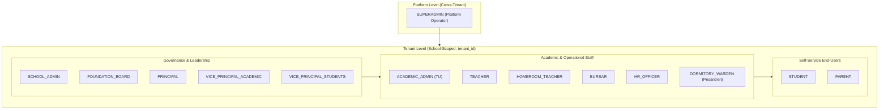

# Roles and Permissions Specification

## Overview

**Ilmiya** is a multi-tenant School Management System (SMS) and Educational ERP designed for primary, secondary, vocational, and Islamic educational institutions (SD, SMP, SMA, SMK, MI, MTs, MA, and Pesantren).

This document establishes the official business and security specification for **Role-Based Access Control (RBAC)** in Ilmiya. It defines:
1. **Tenancy and Authorization Scopes**
2. **Standard User Roles** across administrative, academic, operational, and self-service tiers
3. **Fine-Grained Permissions Catalog** structured in `{domain}:{resource}:{action}` notation
4. **Role-to-Permission Matrix** detailing operational capabilities and contextual boundaries

---

## 1. Tenancy Hierarchy & Authorization Scopes

Ilmiya employs a multi-tenant architecture with strict tenant isolation enforced at both the application layer (`TenantContext` powered by Java 25 `ScopedValue`) and the database layer (tenant discriminator column `tenant_id`).

### Authorization Levels



### Data Boundary Scopes

In addition to coarse-grained role permissions, Ilmiya evaluates **contextual data boundaries**:

| Scope Code | Scope Name | Description | Example Application |
|---|---|---|---|
| **`GLOBAL`** | Platform-Wide | Applies across all tenants. Only accessible by platform superadministrators. | Tenant provisioning, platform subscription management |
| **`TENANT`** | Institutional Scope | Bound to the active tenant (`tenant_id`). User can access all matching records across the school. | Academic admin browsing all student records |
| **`HOMEROOM`** | Homeroom Scope | Restricted to the student batch or class supervised by the homeroom teacher (*Wali Kelas*). | Reviewing semester e-Rapor remarks, checking morning roll call |
| **`ASSIGNED`** | Subject / Teacher Scope | Restricted to classes, courses, or subjects directly allocated to the teacher in the timetable. | Recording midterm exam marks for 10-A Mathematics |
| **`SELF`** | User Self-Service | Restricted strictly to the authenticated user's own profile and records. | Teacher requesting annual leave, student viewing schedule |
| **`WARD`** | Guardian Scope | Restricted to students actively linked to the parent/guardian user account. | Parent viewing report cards and paying SPP fees for their children |

---

## 2. Standard Role Definitions

Roles in Ilmiya represent logical collections of permissions suited to institutional job functions.

### Tier 1: Platform Administration

#### `SUPERADMIN` (Platform Administrator)
- **Persona**: Ilmiya SaaS operations engineer or hosting provider system administrator.
- **Scope**: Platform-wide (`GLOBAL`).
- **Responsibilities**:
  - Provision, activate, suspend, and archive school tenants.
  - Monitor global system health, database migrations, and resource metrics.
  - Manage platform-wide feature flags and licensing.
  - Does not participate in daily school academic operations.

---

### Tier 2: Institutional Leadership & Governance

#### `SCHOOL_ADMIN` (Administrator Sekolah)
- **Persona**: School IT administrator or head of administrative computer operations.
- **Scope**: Entire School (`TENANT`).
- **Responsibilities**:
  - Full configuration of the school tenant profile (name, NPSN, address, branding).
  - Setup institutional operational settings (working days, grading format preference, term layouts).
  - Manage tenant staff user accounts, password resets, and role assignments.
  - Access system audit logs and data export/import utilities.

#### `FOUNDATION_BOARD` (Pengurus Yayasan / School Board)
- **Persona**: Board member, foundation trustee, or executive director managing one or multiple schools under a yayasan.
- **Scope**: Entire School / Multi-School Group (`TENANT`).
- **Responsibilities**:
  - Executive oversight of institutional enrollment and retention trends.
  - High-level financial reporting (tuition revenue collection vs. outstanding arrears).
  - High-level academic performance summaries and graduation rates.
  - Read-only access to institutional audit trails; no day-to-day transaction entry.

#### `PRINCIPAL` (Kepala Sekolah / Mudir)
- **Persona**: Head of school or head of madrasah/pesantren.
- **Scope**: Entire School (`TENANT`).
- **Responsibilities**:
  - Institutional governance and policy compliance.
  - Final approval and locking of semester grades and e-Rapor report cards.
  - Final approval of staff leave requests and major disciplinary actions.
  - Institutional reporting to government education boards (Dapodik / EMIS).

#### `VICE_PRINCIPAL_ACADEMIC` (Wakil Kepala Sekolah Bidang Kurikulum)
- **Persona**: Vice principal for curriculum and academic development.
- **Scope**: Entire School (`TENANT`).
- **Responsibilities**:
  - Configure academic years, semesters/terms, and curriculum frameworks (Kurikulum Merdeka / K13).
  - Maintain subject catalog and allocate subjects to classes.
  - Design and publish timetable schedules and institutional academic calendars.
  - Oversee exam schedules, assessment components, and grade submission deadlines.
  - Execute end-of-year student promotion and graduation workflows.

#### `VICE_PRINCIPAL_STUDENTS` (Wakil Kepala Sekolah Bidang Kesiswaan)
- **Persona**: Vice principal for student affairs and extracurricular activities.
- **Scope**: Entire School (`TENANT`).
- **Responsibilities**:
  - Oversee student admissions (PPDB / Penerimaan Peserta Didik Baru).
  - Manage student conduct, disciplinary infractions, and merit/demerit point records.
  - Supervise extracurricular allocations and student council (OSIS / IPM) activities.
  - Coordinate student counseling, attendance interventions, and parent notifications.

---

### Tier 3: Academic, Operational & Administrative Staff

#### `ACADEMIC_ADMIN` (Staf Tata Usaha / TU / Registrar)
- **Persona**: School administration office staff (*Staf Tata Usaha*).
- **Scope**: Entire School (`TENANT`).
- **Responsibilities**:
  - Register new students and verify civil documents (birth certificates, KK, NISN).
  - Manage class batch enrollments and class transfers.
  - Generate official school documentation (surat keterangan aktif, transkrip sementara).
  - Compile and verify Dapodik/EMIS export datasets.

#### `TEACHER` (Guru Mata Pelajaran / Ustadz)
- **Persona**: Subject educator or pesantren religious teacher.
- **Scope**: Assigned classes and subjects (`ASSIGNED`), plus self-service (`SELF`).
- **Responsibilities**:
  - View personal teaching timetable and schedule allocations.
  - Take period-level subject attendance during teaching blocks.
  - Create assessments (formative quizzes, homework, summative exams) and input marks.
  - Provide qualitative remarks on student learning competencies.

#### `HOMEROOM_TEACHER` (Wali Kelas)
- **Persona**: Classroom supervisor and primary student mentor.
- **Scope**: Supervised class batch (`HOMEROOM`), in addition to `TEACHER` permissions.
- **Responsibilities**:
  - Conduct daily morning roll call and track student absence reasons (sakit, izin, alpa).
  - Verify parent doctor's notes and excuse letters.
  - Monitor aggregate academic progress, attendance percentages, and behavior of homeroom students.
  - Synthesize subject grades, extracurricular participation, and write character notes for semester e-Rapor.
  - Generate and review draft student report cards before principal lock.

#### `BURSAR` (Bendahara / Staf Keuangan)
- **Persona**: School cashier, bursar, or finance officer (*Tata Usaha Keuangan*).
- **Scope**: Entire School (`TENANT`).
- **Responsibilities**:
  - Configure fee schedules (SPP bulanan, uang gedung/pangkal, praktikum, seragam, buku).
  - Set up student fee concessions, scholarships (KIP, Beasiswa Prestasi), and sibling discounts.
  - Generate monthly student fee invoices and payment reminders.
  - Receive cash/bank transfer payments, record transactions, and issue official receipts.
  - Maintain daily cashbooks and prepare debt/arrears tracking reports.

#### `HR_OFFICER` (Staf Kepegawaian / HR)
- **Persona**: Human resources officer or administrative staff in charge of employment.
- **Scope**: Entire School (`TENANT`).
- **Responsibilities**:
  - Maintain employee records for permanent teachers (GTY/PNS), honorarium teachers (GTT), and administrative staff.
  - Track employment contracts, NUPTK, certifications, and teaching hour quotas.
  - Manage staff daily attendance logs and leave balances.
  - Calculate monthly payroll batches, allowances (tunjangan wali kelas/mengajar), deductions (kasbon), and distribute payslips.

#### `DORMITORY_WARDEN` (Pembina Asrama / Musyrif) *(Pesantren / Boarding)*
- **Persona**: Boarding school supervisor or pesantren dorm mentor (*Musyrif / Musyrifah*).
- **Scope**: Supervised dormitory rooms/halqah (`HOMEROOM` equivalent).
- **Responsibilities**:
  - Manage boarding student check-in, night curfews, and hostel attendance.
  - Monitor boarding routines (shalat berjamaah, tahfidz Al-Qur'an, kajian kitab kuning).
  - Process student weekend exit permits (izin pesiar / pulang).
  - Record disciplinary incidents or health complaints occurring inside the dormitory.

---

### Tier 4: Self-Service End-Users

#### `STUDENT` (Siswa / Santri)
- **Persona**: Enrolled student or pesantren santri.
- **Scope**: Self (`SELF`).
- **Responsibilities**:
  - View personal daily timetable, room locations, and teacher allocations.
  - View personal attendance history and monthly summary percentages.
  - Check upcoming examination schedules, homework, and continuous assessment marks.
  - Download published semester report cards (e-Rapor).
  - View fee billing status and payment history.

#### `PARENT` (Orang Tua / Wali Murid)
- **Persona**: Father, mother, or legal guardian of enrolled students.
- **Scope**: Linked children (`WARD`).
- **Responsibilities**:
  - View real-time attendance alerts and morning roll call notifications for linked children.
  - Submit digital absence requests along with doctor's notes (surat keterangan dokter).
  - Monitor academic marks, teacher remarks, and download certified e-Rapor.
  - Review upcoming fee invoices (SPP), download payment receipts, and view payment balances.
  - Access school announcements, circular letters, and event calendars.

---

## 3. Fine-Grained Permissions Catalog

All permissions adhere strictly to the `{domain}:{resource}:{action}` naming convention, facilitating wildcard-based security definitions in `@RequirePermission` evaluations.

### 3.1 School & Core Administration (`school:*`)

| Permission String | Description |
|---|---|
| `school:profile:read` | View institutional profile (name, NPSN, address, contact). |
| `school:profile:write` | Modify school profile, accreditation details, and branding assets. |
| `school:settings:manage` | Configure operational parameters (working days, grading preference, term layout). |
| `school:user:manage` | Create, invite, deactivate user accounts, and assign tenant roles. |
| `school:audit:read` | Inspect immutable audit logs of domain mutations. |

### 3.2 Academic Structure & Curriculum (`academic:*`)

| Permission String | Description |
|---|---|
| `academic:year:read` | View academic years and operational status. |
| `academic:year:write` | Create and activate/archive academic years. |
| `academic:term:read` | View academic terms and semester boundaries. |
| `academic:term:write` | Add, activate, and close academic terms/semesters. |
| `academic:curriculum:read` | Browse curriculum frameworks, learning objectives, and syllabi. |
| `academic:curriculum:manage` | Configure curriculum structures and grading standards. |
| `academic:course:read` | View master subject catalog. |
| `academic:course:write` | Create and modify subjects (code, name, category, credit hours). |
| `academic:class:read` | View grade levels, batch sections, and class enrollments. |
| `academic:class:write` | Create and configure class sections (e.g. 7-A, 10-IPA-1) and capacity. |
| `academic:promotion:manage` | Execute student batch promotion, retention, and graduation workflows. |

### 3.3 Student Lifecycle & Admissions (`student:*`)

| Permission String | Description |
|---|---|
| `student:profile:read` | View student demographic and academic profile data. |
| `student:profile:write` | Create, edit, and update student master profiles. |
| `student:admission:manage` | Process new student admissions (PPDB applications, entrance testing, status). |
| `student:enrollment:manage` | Assign and transfer students to classes and tracks. |
| `student:guardian:manage` | Link parent/guardian accounts to student profiles and set primary contacts. |
| `student:document:read` | Download student civil documentation (KK, akta kelahiran, ijazah). |
| `student:document:write` | Upload and verify student identity and compliance documents. |
| `student:conduct:read` | View student disciplinary records, merit/demerit points, and awards. |
| `student:conduct:manage` | Record behavioral infractions, counseling notes, and merit points. |

### 3.4 Attendance Tracking (`attendance:*`)

| Permission String | Description |
|---|---|
| `attendance:student:read` | View student daily and period attendance records. |
| `attendance:student:record` | Submit attendance roll call (present, sick, permitted, absent). |
| `attendance:student:update` | Amend or correct recorded student attendance logs. |
| `attendance:student:excuse` | Submit and approve absence justification letters and medical certificates. |
| `attendance:staff:read` | View staff daily check-in and attendance summaries. |
| `attendance:staff:record` | Record staff daily attendance check-in/check-out. |
| `attendance:staff:approve` | Review and approve staff attendance corrections or remote check-ins. |

### 3.5 Timetable & Institutional Calendar (`timetable:*`)

| Permission String | Description |
|---|---|
| `timetable:schedule:read` | View class schedules, period timing sets, and teacher allocations. |
| `timetable:schedule:manage` | Generate, edit, and publish class time slots, subject slots, and room allocations. |
| `timetable:calendar:read` | View school calendar events, exam weeks, and holidays. |
| `timetable:calendar:manage` | Create, update, and publish institutional events, holidays, and schedule adjustments. |

### 3.6 Examination, Assessment & e-Rapor (`exam:*`)

| Permission String | Description |
|---|---|
| `exam:schedule:read` | View examination timetables and assessment periods. |
| `exam:schedule:manage` | Set up exam sessions (PTS, PAS, Asesmen Sumatif Akhir Jenjang). |
| `exam:grade:read` | View recorded marks and component scores. |
| `exam:grade:create` | Record formative, summative, and homework scores for assigned classes. |
| `exam:grade:update` | Update or adjust recorded marks before grade submission deadline. |
| `exam:grade:lock` | Lock grade entry for an exam period to prevent further modifications. |
| `exam:report-card:read` | View compiled e-Rapor student progress reports. |
| `exam:report-card:generate` | Aggregate scores, attendance, extracurriculars, and generate draft report cards. |
| `exam:report-card:publish` | Publish certified digital e-Rapor cards to student and parent portals. |

### 3.7 Finance, Fee Management & Cashbook (`finance:*`)

| Permission String | Description |
|---|---|
| `finance:fee:read` | View fee catalog, fee schedules, and pricing rules. |
| `finance:fee:manage` | Define fee categories (SPP, gedung), amounts, and scholarship discounts. |
| `finance:invoice:read` | View student billing statements and invoices. |
| `finance:invoice:create` | Generate recurring monthly fee invoices and ad-hoc bills. |
| `finance:payment:read` | View payment history, payment receipts, and collection logs. |
| `finance:payment:create` | Record fee collection transactions and issue signed receipts. |
| `finance:payment:void` | Void erroneously posted payment records (restricted privilege). |
| `finance:report:read` | View fee collection summaries, cashbook ledgers, and overdue arrears aging. |

### 3.8 Human Resources & School Payroll (`hr:*`)

| Permission String | Description |
|---|---|
| `hr:staff:read` | View staff master profiles, departments, and designations. |
| `hr:staff:write` | Add and update employee records, contracts, NUPTK, and certifications. |
| `hr:assignment:read` | View teacher subject allocations and homeroom appointments. |
| `hr:assignment:manage` | Assign teaching allocations, subject responsibilities, and homeroom roles. |
| `hr:leave:request` | Submit employee leave applications. |
| `hr:leave:approve` | Review, approve, or reject staff leave requests. |
| `hr:payroll:read` | View salary components and personal/school payslips. |
| `hr:payroll:calculate` | Execute monthly payroll calculations based on attendance and teaching hours. |
| `hr:payroll:disburse` | Finalize payroll disbursement batches and release payslips. |

### 3.9 Audit Trail & System Observability (`audit:*`)

| Permission String | Description |
|---|---|
| `audit:log:read` | Inspect immutable audit logs of domain mutations. |

---

## 4. Role-to-Permission Matrix

The following matrix defines the operational capabilities assigned to each standard role.

### Legend
- **`ALL`**: Complete administrative management across the resource (`domain:resource:*` or `domain:*`).
- **`Read`**: Read-only access across the entire school tenant.
- **`Manage`**: Create, edit, and operate within the resource.
- **`Scoped`**: Permission granted but dynamically bounded by data ownership:
  - `Assigned`: Classes or subjects assigned to the teacher.
  - `Homeroom`: Students belonging to the teacher's supervised homeroom.
  - `Self`: User's own personal data.
  - `Ward`: Linked child/children of the parent.
- **`Approve` / `Lock`**: Specific high-privilege governance workflow action.
- **`—`**: No access.

| Resource / Capability | `SUPERADMIN` | `SCHOOL_ADMIN` | `FOUNDATION_BOARD` | `PRINCIPAL` | `WAKA_KURIKULUM` | `WAKA_KESISWAAN` | `ACADEMIC_ADMIN` | `TEACHER` | `HOMEROOM_TEACHER` | `BURSAR` | `HR_OFFICER` | `STUDENT` | `PARENT` |
|---|:---:|:---:|:---:|:---:|:---:|:---:|:---:|:---:|:---:|:---:|:---:|:---:|:---:|
| **`school:profile`** | ALL | ALL | Read | Read | Read | Read | Read | Read | Read | Read | Read | Read | Read |
| **`school:settings`** | ALL | ALL | Read | Read | — | — | — | — | — | — | — | — | — |
| **`school:user`** | ALL | ALL | — | Read | — | — | — | — | — | — | — | — | — |
| **`school:audit`** | ALL | ALL | Read | Read | — | — | — | — | — | — | — | — | — |
| **`academic:year`** | ALL | ALL | Read | ALL | ALL | Read | Read | Read | Read | Read | Read | Read | Read |
| **`academic:term`** | ALL | ALL | Read | ALL | ALL | Read | Read | Read | Read | Read | Read | Read | Read |
| **`academic:curriculum`**| ALL | ALL | Read | Read | ALL | — | Read | Read | Read | — | — | — | — |
| **`academic:course`** | ALL | ALL | Read | Read | ALL | — | Read | Read | Read | — | — | — | — |
| **`academic:class`** | ALL | ALL | Read | Read | ALL | Read | ALL | Read | Read | — | — | Scoped | Scoped |
| **`academic:promotion`**| ALL | ALL | — | Approve | ALL | Read | Manage | — | Input | — | — | — | — |
| **`student:profile`** | ALL | ALL | Read | Read | Read | ALL | ALL | Scoped | Homeroom | Read | — | Self | Ward |
| **`student:admission`**| ALL | ALL | Read | Read | — | ALL | ALL | — | — | Read | — | — | — |
| **`student:enrollment`**| ALL | ALL | Read | Read | Manage | ALL | ALL | — | — | — | — | — | — |
| **`student:guardian`** | ALL | ALL | — | Read | — | Manage | ALL | — | Homeroom | Read | — | Self | Ward |
| **`student:document`** | ALL | ALL | — | Read | — | ALL | ALL | — | Homeroom | — | — | Self | Ward |
| **`student:conduct`** | ALL | ALL | Read | Read | Read | ALL | Read | Input | Homeroom | — | — | Self | Ward |
| **`attendance:student`**| ALL | ALL | Read | Read | Read | ALL | Manage | Assigned | Homeroom | — | — | Self | Ward |
| **`attendance:staff`** | ALL | ALL | Read | ALL | Read | Read | Read | Self | Self | — | ALL | — | — |
| **`timetable:schedule`**| ALL | ALL | Read | Read | ALL | Read | Read | Assigned | Homeroom | — | — | Self | Ward |
| **`timetable:calendar`**| ALL | ALL | Read | ALL | ALL | ALL | Read | Read | Read | Read | Read | Read | Read |
| **`exam:schedule`** | ALL | ALL | Read | Read | ALL | Read | Read | Read | Read | — | — | Self | Ward |
| **`exam:grade`** | ALL | ALL | Read | Read | Read | — | Read | Assigned | Homeroom | — | — | Self | Ward |
| **`exam:report-card`** | ALL | ALL | Read | Lock | Review | Read | Generate | Input | Generate | — | — | Self | Ward |
| **`finance:fee`** | ALL | ALL | Read | Read | — | — | Read | — | — | ALL | — | Read | Read |
| **`finance:invoice`** | ALL | ALL | Read | Read | — | — | — | — | — | ALL | — | Self | Ward |
| **`finance:payment`** | ALL | ALL | Read | Read | — | — | — | — | — | ALL | — | Self | Ward |
| **`finance:report`** | ALL | ALL | ALL | Read | — | — | — | — | — | ALL | — | — | — |
| **`hr:staff`** | ALL | ALL | Read | Read | Read | Read | Read | Self | Self | — | ALL | — | — |
| **`hr:assignment`** | ALL | ALL | Read | Read | ALL | — | Read | Read | Read | — | ALL | — | — |
| **`hr:leave`** | ALL | ALL | — | Approve | — | — | — | Request | Request | Request | ALL | — | — |
| **`hr:payroll`** | ALL | ALL | Read | Read | — | — | — | Self | Self | Read | ALL | — | — |
| **`audit:log`** | ALL | ALL | Read | Read | — | — | — | — | — | — | — | — | — |

---

## 5. Security & Technical Implementation Guide

### 5.1 Enforcing Permissions in Adapters

Inbound driving adapters (REST controllers) secure business use-case execution using the `ed-iam` annotation `@RequirePermission`:

```kotlin
@RestController
@RequestMapping("/api/v1/academic-years")
class AcademicYearController(
    private val createAcademicYearUseCase: CreateAcademicYearUseCase,
    private val getAcademicYearUseCase: GetAcademicYearUseCase
) {

    @GetMapping
    @RequirePermission(IlmiyaPermissions.ACADEMIC_YEAR_READ)
    fun listAcademicYears(): ApiResponse<List<AcademicYearResponse>> {
        // ...
    }

    @PostMapping
    @RequirePermission(IlmiyaPermissions.ACADEMIC_YEAR_WRITE)
    fun createAcademicYear(@Valid @RequestBody request: CreateAcademicYearRequest): ApiResponse<AcademicYearResponse> {
        // ...
    }
}
```

### 5.2 Dynamic Data Ownership Enforcement

While method-level security verifies the user holds the coarse-grained permission (e.g. `exam:grade:create`), use-case services enforce contextual data scoping before executing state changes:

```kotlin
@Service
class RecordExamGradeService(
    private val timetablePort: TimetableQueryPort,
    private val examGradeRepository: ExamGradeRepository
) : RecordExamGradeUseCase {

    override fun recordGrade(command: RecordExamGradeCommand) {
        val currentActor = SecurityContextHolder.getActor()
        
        // Ensure teacher is assigned to this specific course and class batch
        if (!currentActor.hasGlobalRole(Role.SCHOOL_ADMIN)) {
            val isAssigned = timetablePort.isTeacherAssignedToBatch(
                teacherId = currentActor.id,
                batchId = command.classBatchId,
                courseId = command.courseId
            )
            if (!isAssigned) {
                throw AccessDeniedException("Teacher is not allocated to teach this class batch.")
            }
        }
        
        // Execute grade recording...
    }
}
```

### 5.3 Wildcard Matching & Role Templates

The `ed-iam` permission evaluation engine natively resolves hierarchical wildcards. For example:
- A user with permission `academic:*` automatically matches:
  - `academic:year:read`
  - `academic:year:write`
  - `academic:class:write`
  - `academic:promotion:manage`
- A user with `student:profile:*` matches both `student:profile:read` and `student:profile:write`.

Tenants can customize permissions per role, but Ilmiya pre-configures standard role templates out-of-the-box upon tenant registration.
