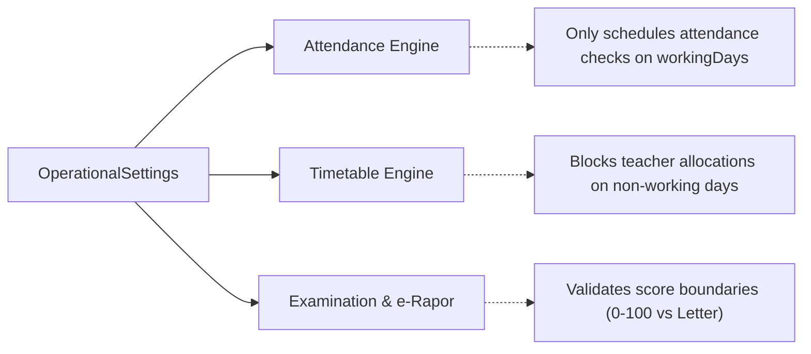

# How-To: Configuring School Operational & Institutional Settings

This guide walks through configuring school working days, grading scales, and term layouts in **Ilmiya**.

---

## Overview

Operational settings dictate how calendar schedules, attendance records, exam gradebooks, and timetable builders behave for a given school tenant:

- **Working Days (`workingDays`)**: The days of the week on which instruction occurs. Determines valid days for timetable slot generation and student/staff attendance tracking.
- **Grading Preference (`gradingPreference`)**: The institutional grading standard applied across assessment components and e-Rapor generation.
- **Term Layout (`termLayout`)**: The structural partitioning of the academic year (Semester, Trimester, Quarter).

---

## Step 1: Inspect Current Operational Settings

Retrieve the currently active school settings via `GET /api/v1/schools/profile`:

```bash
curl -s -X GET http://localhost:8080/api/v1/schools/profile \
  -H "Authorization: Bearer <JWT_ACCESS_TOKEN>" \
  -H "X-Tenant-ID: sma-nusantara-1" | jq '{workingDays, gradingPreference, termLayout}'
```

**Output:**
```json
{
  "workingDays": [
    "MONDAY",
    "TUESDAY",
    "WEDNESDAY",
    "THURSDAY",
    "FRIDAY"
  ],
  "gradingPreference": "NUMERIC_0_100",
  "termLayout": "SEMESTER"
}
```

---

## Step 2: Update Operational Settings

Send a `PUT` request to `/api/v1/schools/settings`.

> [!NOTE]
> The executing user must have the `school:settings:manage` permission.

### Example A: 6-Day School Week (Common in Pesantren / Vocational Schools)
```bash
curl -i -X PUT http://localhost:8080/api/v1/schools/settings \
  -H "Authorization: Bearer <JWT_ACCESS_TOKEN>" \
  -H "X-Tenant-ID: sma-nusantara-1" \
  -H "Content-Type: application/json" \
  -d '{
    "workingDays": [
      "MONDAY",
      "TUESDAY",
      "WEDNESDAY",
      "THURSDAY",
      "FRIDAY",
      "SATURDAY"
    ],
    "gradingPreference": "NUMERIC_0_100",
    "termLayout": "SEMESTER"
  }'
```

### Example B: International / Trimester School Layout
```bash
curl -i -X PUT http://localhost:8080/api/v1/schools/settings \
  -H "Authorization: Bearer <JWT_ACCESS_TOKEN>" \
  -H "X-Tenant-ID: intl-academy" \
  -H "Content-Type: application/json" \
  -d '{
    "workingDays": [
      "MONDAY",
      "TUESDAY",
      "WEDNESDAY",
      "THURSDAY",
      "FRIDAY"
    ],
    "gradingPreference": "LETTER_A_E",
    "termLayout": "TRIMESTER"
  }'
```

**Expected Response (`200 OK`):**
Returns the full `SchoolResponse` payload reflecting the updated settings.

---

## Step 3: Supported Setting Options

### 1. Grading Preferences (`gradingPreference`)

| Value | Scale | Description & Typical Usage |
|-------|-------|-----------------------------|
| `NUMERIC_0_100` | 0.00 – 100.00 | Standard Indonesian National Curriculum (Kurikulum Merdeka / K13). |
| `LETTER_A_E` | A, B, C, D, E | Traditional letter-grade scale. |
| `PERCENTAGE` | 0% – 100% | Percentage-based aggregate reporting. |
| `GPA_4_0` | 0.00 – 4.00 | 4.0-scale GPA system (International / Senior secondary). |

### 2. Term Layouts (`termLayout`)

| Value | Structure | Terms per Year |
|-------|-----------|----------------|
| `SEMESTER` | 2 Terms | Semester 1 (Ganjil) & Semester 2 (Genap) |
| `TRIMESTER` | 3 Terms | Term 1, Term 2, Term 3 |
| `QUARTER` | 4 Terms | Quarter 1, Quarter 2, Quarter 3, Quarter 4 |

---

## Step 4: Downstream Module Implications

Changing these settings immediately impacts downstream domain logic:



1. **Attendance Engine (`ilmiya-attendance`)**:
   - Automated daily absence trackers skip non-working days (e.g. Sunday in 6-day weeks, Saturday & Sunday in 5-day weeks).
2. **Timetable Engine (`ilmiya-timetable`)**:
   - Weekly master schedule grids only generate period slots for configured `workingDays`.
3. **Examination & Grading (`ilmiya-exam`)**:
   - Assessment score recording endpoints validate that entered marks conform to the configured `gradingPreference`.

---

## Troubleshooting & Validations

| Error Code | Reason | Resolution |
|------------|--------|------------|
| `400 Bad Request` | `workingDays` was submitted as an empty array `[]`. | At least one day of the week must be specified. |
| `400 Bad Request` | Invalid enum string passed (e.g. `"gradingPreference": "NUMERIC_10"`). | Ensure values match `GradingPreference` or `TermLayout` enums. |
| `403 Forbidden` | Authenticated user lacks `school:settings:manage`. | Grant `school:settings:manage` or `school:*` permission in `ed-iam`. |
